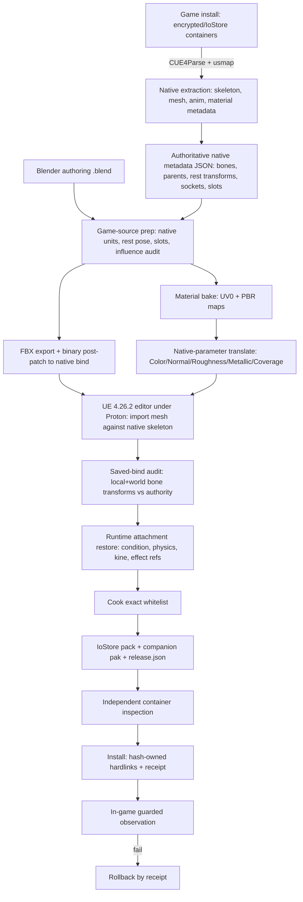

# 00 — Overview: the pipeline on one page

## Goal

Replace a playable character's outfit (mesh + materials + optionally animations) in FF7 Rebirth with custom Blender-authored content, distribute it as an IoStore container under `End/Content/Paks/~mods/`, and verify it in the running game — on Linux, Steam, Proton.

## Architecture map

## Stages and what "done" means

| # | Stage | Done means (evidence) | Doc |
|---|---|---|---|
| 1 | Toolchain | each tool run once on a trivial input; versions recorded | 02 |
| 2 | Native extraction | native metadata JSON incl. 8-influence skin and all LODs | 03 |
| 3 | Blender authoring | saved/reopened scene passes geometry QA; art approved by the human | 04 |
| 4 | Game-source prep | prepared source manifest; source hash unchanged | 05, 06 |
| 5 | FBX export | re-parsed FBX equals authority within tolerance | 07 |
| 6 | Materials | bakes non-overlapping in 0..1; native-parameter plan | 08, 09 |
| 7 | Editor import | saved mesh has all bones, parents, bound materials | 10 |
| 8 | Saved-bind audit | local+global deltas ≈ float noise | 10 |
| 9 | Runtime attachments | decoded saved+cooked graphs resolve to real native objects | 11 |
| 10 | Animation (optional) | saved+cooked event/curve/root parity; separate-process reload | 12 |
| 11 | Cook/pack | exact expected package set; bulk chunks listed | 13 |
| 12 | Container inspection | decoded container params/pixels match plan | 13, 09 |
| 13 | Install/rollback | receipt; rollback proven | 14 |
| 14 | In-game | per-gate observation (appearance, deformation, movement, combat, physics, face, rollback) | 15 |

## Where the time went (observed in the source project) [OBSERVED]

Roughly in order of cost:

1. **Toolchain recovery**: extractors that silently dropped data (influences, LODs), container converters that failed on a game-specific header word, getting authorised access to the matching editor source, running the editor under Proton, generating a type-mapping file from the running game.
2. **Material model mismatch**: custom shaders/UMaterials did not render correctly in game; fix was binding *native* parent material instances with texture parameters.
3. **Missing runtime attachments**: the replacement mesh lacked the donor/native links (condition model, driver data, physics asset, effect mesh) that the native mesh carries.
4. **Art iteration with late rejection**: dozens of Blender revisions; the human rejected a deployed appearance after the whole technical pipeline had been run on it. → Get approval on cheap renders before running the heavy pipeline, then keep a stable contract so any approved scene flows through unchanged.
5. **Environment incidents**: host X11 socket loss (no game window; editor hang), accidental .NET dev-cert creation, game crashes of unknown cause.

## Core design decisions that held up [DECISION]

* Replace **native asset paths** with owned packages (override model); reference the native shared skeleton and shader parents, never ship them.
* A single **authoritative native-metadata JSON** (bones, parents, rest transforms, sockets, slot names) is the source of truth that Blender prep, FBX patching, editor audit and animation rebasing all check against.
* **Immutable, hash-pinned stage outputs** with a status vocabulary: `PASS`, `FAIL`, `NOT_RUN`, `BLOCKED`, `NEEDS_ART_REVIEW`.
* **Install by hardlink + receipt**, never overwrite; rollback by receipt, never delete user-modified files.
