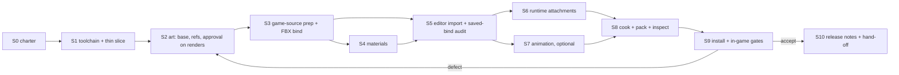

# 17 — Playbook: starting a brand-new character-model mod

Ordered plan with gates. Everything is "as tested" (see README scope). The central strategy — learned from where the source project lost the most time — is **prove the whole pipe with the dumbest possible asset first, get art approved on cheap renders second, and only then spend heavy effort.**

## 0. Ground rules for the agent [DECISION]

1. Read [docs/01](01-evidence-discipline.md) first. Use its status vocabulary and evidence tags in every report.
2. Create the work repo with a `.gitignore` that excludes: game extractions, models/textures/renders, FBX/PSK, editor project/profile, caches/tools, saves, private inventories/backups, credentials, any author archives. Commit only code, docs, redacted configs. [Everything the source project kept local-only.]
3. **Ask the human only for what tools can't decide**: art approval, permission to launch the game/stop a service, account-bound downloads (editor access requires an authorised account link), and risky actions. For everything else, choose the conservative option, state it, proceed.
4. The human may delegate heavy sub-tasks to sub-agents. Give each sub-agent the full slice contract (inputs, outputs, forbidden actions, evidence format) — they start blank. If your environment has Blender skills, **load them first for every Blender step** (also in delegated work); apply their procedures, not just their names.
5. One immutable output directory per stage run (docs/01). Never overwrite.
6. Keep a **candidate ledger** (`templates/candidate-ledger.md`): one row per candidate with stage statuses, hashes, receipt, and in-game result.

## 1. Stage map

Parallel lanes: S1 toolchain pieces (extractor / editor / Blender smoke) are independent; S4 material plan and S5 geometry import can proceed in parallel until cook; S6 and S7 are independent.

## 2. Stages

### S0 — Charter (≤ 1 session)
* Write the **scope statement**: which character/outfit slot is replaced, what's in scope (mesh, materials, animations?), out of scope (combat, facial, physics, other outfits), game build id, and which gates are required for "done".
* Record the human's boundaries: which services may be stopped; whether the agent may launch the game; what must never change (launch options, saves, unrelated mods).
* Gate: charter file exists, human acknowledged it.

### S1 — Toolchain and the thin vertical slice
**Goal:** one trivially modified native asset goes extract → Blender → FBX → editor → cook → pack → inspect → install → in-game → rollback.
1. Environment + smoke (docs/02): record every version; run each tool once on a trivial input.
2. Native extraction (docs/03) of the target mesh/skeleton; authoritative metadata JSON.
3. Native round trip: export the *native* mesh unchanged through Blender and the whole pipe (**the stock round trip**). This isolates pipeline defects from art defects. Any bind/influence/LOD difference is a pipeline bug.
4. Then a trivial change (hue shift of one material, scaled accessory). Run docs/10 → 13.
5. Install (docs/14) a release containing it, observe in game (docs/15), roll back, observe stock.
* **Gate:** one install + in-game observation + proven rollback with the dumb asset. Until then do **not** invest in detailed modelling.
* Expected snags: editor access (account-bound), display for the editor (P14), extractor correctness (P2), converter header word (P4), mapping file (docs/02).

### S2 — Art: base selection, references, approval
* **Base selection by rubric** before modelling: anatomy, UV quality, weights, licence/permissions (some authors forbid reuse or modification — read it; don't feed prohibited assets into your pipeline), polygon budget. The source project burned many revisions swapping bases. [OBSERVED]
* **References:** designate **one** main target image; others supplement (docs/04). Record the references' location privately; do not commit them unless the human says so.
* Contract frozen (docs/04 §1.3): native cm units, native rest rig, bone/UV/vertex-group/slot names.
* Cheap review set (fixed angles, ≤ 900 px, 24–32 Cycles samples): clay + textured. The human approves **art on renders**. Write down *what* was approved (file + hash + date) and what it is **not** ("not physics, not gameplay").
* Gate: dated approval bound to a `.blend` hash. A new approval for a different scene does not retroactively approve others; a rejection of a deployed build is final until the human says otherwise.

### S3 — Game-source prep and FBX bind (docs/05–07)
* Convert approved scene → game-source scene (separate file): native units/rest, slots, influence cap, remove presentation offsets (P22), preserve contract.
* FBX export + **post-patch to native bind** + re-parse and compare to authority.
* Gate: re-parsed FBX equals authority within tolerance; source hash unchanged.

### S4 — Materials (docs/08–09) (parallel with S5)
Bake → translate → native-parent MIC plan. Reject raw bake in the editor stage (P10), sRGB (P11), native parents (P12), no WorldGrid import.

### S5 — Editor import + saved-bind audit (docs/10)
Import on a **fresh** candidate project; run the saved-bind audit; fix bind-pose warnings as defects (P3). Material rebinding (P9) when material class changed.

### S6 — Runtime attachments (docs/11)
After import+audit, before cook; independent inspection; re-run saved-bind audit.

### S7 — Animation (docs/12) — optional
Only if native motion can't drive the new body. Otherwise skip: it removes the riskiest stage.

### S8 — Cook, pack, inspect (docs/13)
Whitelist; cook; expected-vs-actual; IoStore + companion pak; release.json; independent container inspection. All hash-bound.

### S9 — Install and in-game gates (docs/14, 15)
Fresh inventory; backup; install; **observe** the gate matrix; ledger entry. One candidate installed at a time. After a failure, the loop returns to the *cheapest* stage that can fix it (art → S2, packaging → S8 repackage, material → S4/S5, never "rebuild everything").

### S10 — Hand-off
Release notes: scope, gates passed **and not tested**, version gate, rollback command shape, licence/permission notes of any third-party components, how to report a bug. Keep all evidence local.

## 3. Time-boxes and stop conditions [DECISION]

| Situation | Action |
|---|---|
| A stage fails the same way twice | stop; write the hypothesis ledger (what was ruled out); try a different class of hypothesis (e.g. gray materials: packaging → material model → shader parent) |
| Editor hangs with no log | suspect display (P14) before anything else |
| Game crash | triage per docs/15 §5; attribute only with a discriminating experiment |
| Human rejects appearance | back to S2; do not tweak the installed build in place |
| Game patched | stop; version gate; re-extract + re-cook |

## 4. Efficiency rules (what saved time) [OBSERVED / DECISION]

1. Cheapest evidence first (renders before editor, container inspection before launch).
2. Reuse verified outputs via hash-checked copy instead of recomputing (cooked animations, cooked tree for repackage).
3. Single-purpose scripts into fresh dirs with JSON reports; no hidden state.
4. Contract fixed early; art changes shapes, never the contract.
5. Don't re-run passed gates "to be sure" — verify the report hash instead.
6. Keep a running ledger so a fresh agent can resume without re-deriving history (docs/18).

## 5. Questions to settle with the human early (copy into S0)

* Which character/outfit slot? One slot or all?
* Art direction & the single main reference image.
* Is animation replacement wanted (more risk)?
* May the agent launch the game, press keys, stop a named service?
* What counts as "done": renders approved? in-game stable? combat checked?
* Distribution: private only, or publishable (then licences of any base/third-party matter)?
